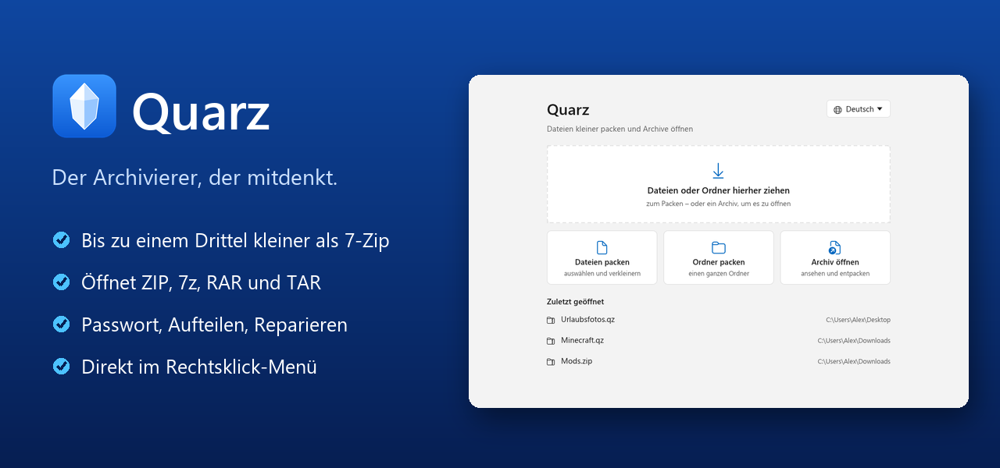
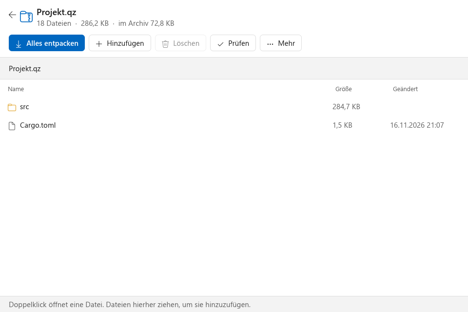
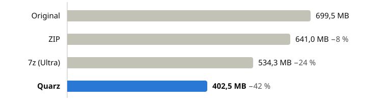
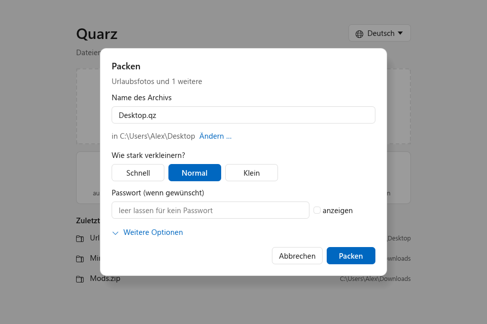
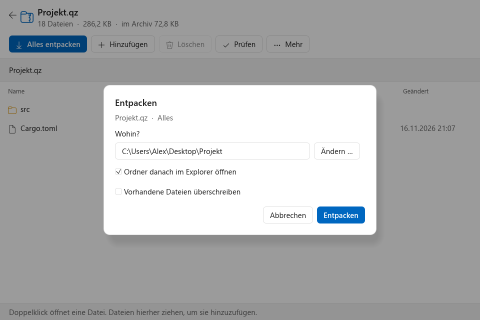
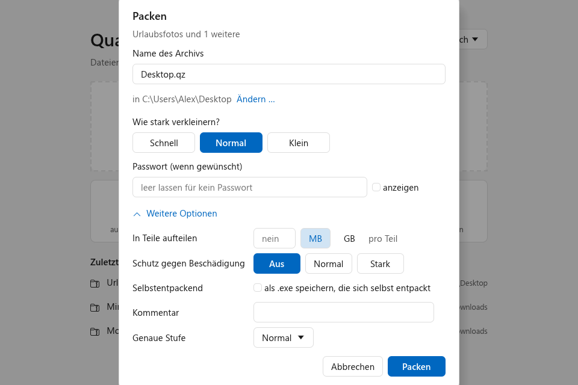
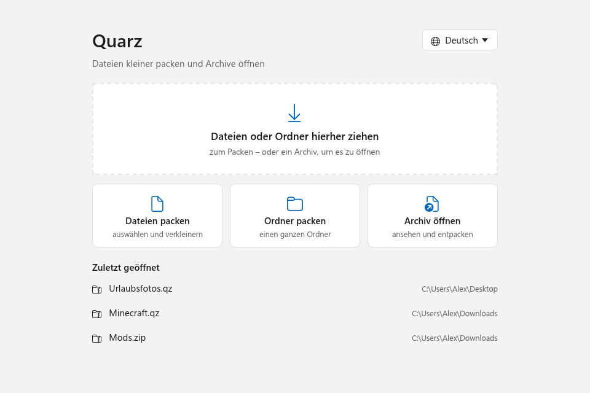
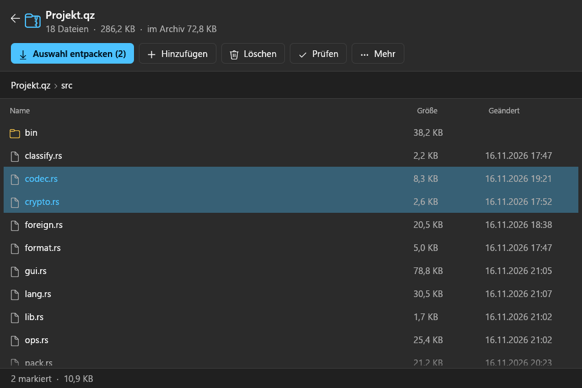
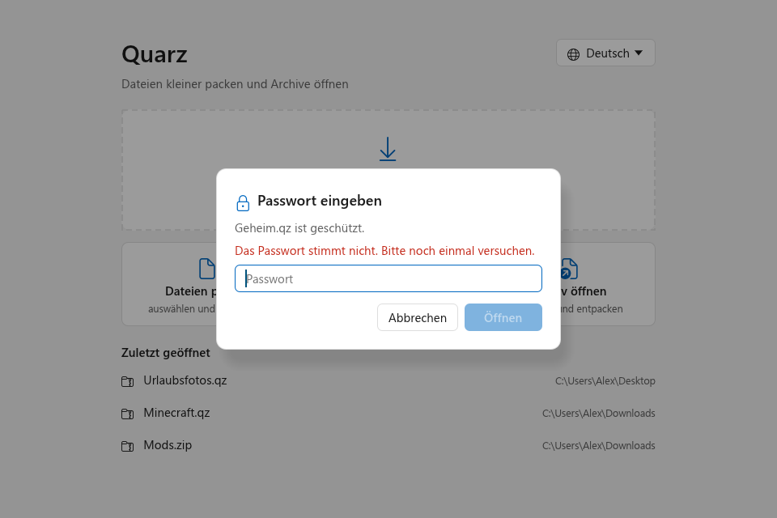
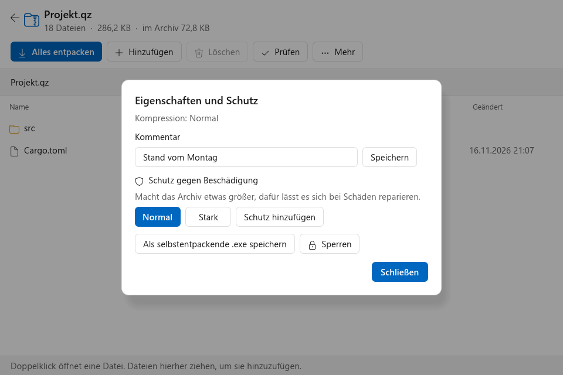

<p align="center">
  <a href="README.md">English</a> · <b>Deutsch</b>
</p>

<p align="center">
  
</p>

<p align="center">
  <a href="https://github.com/morgenich/quarz/releases/latest"><b>⬇ Quarz herunterladen</b></a>
  &nbsp;·&nbsp; <a href="#anleitung">Anleitung</a>
  &nbsp;·&nbsp; <a href="#wie-viel-kleiner">Messwerte</a>
  &nbsp;·&nbsp; <a href="#so-funktioniert-es">So funktioniert es</a>
</p>

---

**Quarz** packt Dateien und Ordner kleiner als ZIP und 7-Zip – und bleibt dabei so einfach wie das Packen in Windows selbst. Ziehen, loslassen, fertig. Archive in anderen Formaten öffnet Quarz natürlich auch.

- **Kleiner.** Auf echten Ordnern im Schnitt **ein Viertel kleiner als 7-Zip Ultra**, bei Programmen und ZIP-Sammlungen sogar über ein Drittel.
- **Einfach.** Eine Startseite, drei große Knöpfe, Rechtsklick-Menü im Explorer. Kein Fachchinesisch.
- **Alles drin, was man von WinRAR kennt.** Passwort, Aufteilen in Teile, Schutz gegen Beschädigung mit Reparatur, selbstentpackende `.exe`, Kommentare, Sperren.
- **Öffnet fast alles.** `.qz`, ZIP, 7z, RAR, TAR, `.tar.gz`, `.tar.xz`, `.tar.bz2`, `.zst`.
- **In deiner Sprache.** Deutsch, English, Español, Français – hell und dunkel.
- **Bitgenau.** Jede Datei kommt Byte für Byte so heraus, wie sie hineingegangen ist. Das wird beim Packen geprüft.

<p align="center">
  
</p>

## Wie viel kleiner?

Gemessen an sechs echten, gemischten Ordnern (zusammen 699,5 MB). Quarz auf der Stufe **Normal**, 7-Zip auf **Ultra**, alles danach entpackt und Byte für Byte verglichen:

<p align="center">
  <picture>
    <source media="(prefers-color-scheme: dark)" srcset="docs/images/chart-de-dark.svg">
    
  </picture>
</p>

| Ordner | Original | ZIP | 7z Ultra | **Quarz** | Quarz gegen 7z |
|---|---:|---:|---:|---:|---:|
| Software-Projekt (Code, Git, Medien) | 117,1 MB | 114,4 MB | 77,1 MB | **52,6 MB** | **−31,8 %** |
| Java-Programme (JAR) | 142,4 MB | 137,9 MB | 115,0 MB | **71,4 MB** | **−38,0 %** |
| Sammlung von ZIP-Dateien | 125,7 MB | 109,5 MB | 100,1 MB | **68,4 MB** | **−31,6 %** |
| Minecraft-Welt | 69,6 MB | 47,1 MB | 44,9 MB | **37,1 MB** | **−17,4 %** |
| PDF-Dokumente | 176,4 MB | 166,1 MB | 137,7 MB | **113,2 MB** | **−17,8 %** |
| Screenshots und Notizen | 68,3 MB | 66,0 MB | 59,5 MB | **59,8 MB** | +0,7 % |
| **Zusammen** | **699,5 MB** | **641,0 MB** | **534,3 MB** | **402,5 MB** | **−24,7 %** |

**Ehrlich gesagt:** Quarz braucht dafür mehr Rechenzeit als 7-Zip, beim Packen ein Mehrfaches. Bei Fotos, Videos und Screenshots gewinnt Quarz kaum etwas – die sind schon so dicht gepackt, dass kein Programm sie nennenswert verkleinert.

## Anleitung

### 1. Installieren

1. Lade die neueste `Quarz-…-windows.zip` unter [**Releases**](https://github.com/morgenich/quarz/releases/latest) herunter.
2. Entpacke sie in einen festen Ordner, zum Beispiel `C:\Users\<du>\Programme\Quarz`.
3. Doppelklicke **`Einrichten.cmd`**. Danach öffnen sich `.qz`-Dateien per Doppelklick und Quarz steht im Rechtsklick-Menü.

> **Windows 11:** Beim Einrichten fragt Quarz, ob es direkt im *ersten* Rechtsklick-Menü erscheinen soll. Windows lässt dort nur signierte App-Pakete zu, deshalb wird dafür einmal das Zertifikat des Quarz-Pakets als vertrauenswürdig eingetragen (Windows fragt nach Administrator-Bestätigung). Sagst du Nein, stehen die Einträge unter *Weitere Optionen anzeigen*.

Entfernen: **`Entfernen.cmd`** doppelklicken, dann den Ordner löschen.

### 2. Packen

**Am schnellsten:** Rechtsklick auf Dateien oder einen Ordner → **Quarz → Zu „Name.qz“ packen**. Quarz legt das Archiv daneben ab und zeigt nur einen kleinen Fortschrittsbalken.

**Mit Optionen:** Ziehe Dateien auf das Quarz-Fenster oder wähle **Dateien packen** / **Ordner packen**.

<p align="center">
  
</p>

| Einstellung | Bedeutung |
|---|---|
| **Schnell / Normal / Klein** | Wie viel Zeit Quarz sich nimmt. *Normal* ist der empfohlene Mittelweg. |
| **Passwort** | Verschlüsselt Inhalt *und* Dateinamen (AES-256). Ohne Passwort kommt niemand hinein – auch nicht mit Quarz. |
| **Weitere Optionen** | Aufteilen, Schutz, selbstentpackend, Kommentar. Siehe unten. |

### 3. Öffnen und entpacken

Doppelklick auf ein Archiv öffnet es. Mit **Alles entpacken** oder nach Markieren einzelner Dateien mit **Auswahl entpacken** holst du den Inhalt heraus. Ein Doppelklick auf eine Datei im Archiv öffnet sie direkt.

<p align="center">
  
</p>

Im Rechtsklick-Menü geht es auch ohne Fenster: **Hier entpacken** oder **In Ordner „Name“ entpacken**.

### 4. Große Archive aufteilen

Unter **Weitere Optionen → In Teile aufteilen** gibst du eine Größe in MB oder GB an, zum Beispiel `4 GB` für einen USB-Stick oder `25 MB` für E-Mails. Quarz schreibt dann `Name.part001.qz`, `Name.part002.qz` usw.

<p align="center">
  
</p>

- **Entpacken:** Lege alle Teile in denselben Ordner und öffne einen beliebigen davon.
- **Wieder zu einer Datei machen:** Archiv öffnen → **Mehr → Eigenschaften und Schutz → Teile zu einer Datei zusammenfügen**. Oder: `qz join Name.part001.qz`.

### 5. Gegen Beschädigung schützen

Mit **Schutz gegen Beschädigung** (*Normal* = 5 %, *Stark* = 10 % größer) legt Quarz Reparaturdaten ins Archiv. Ist später ein Teil der Datei kaputt – etwa durch einen defekten USB-Stick – repariert **Mehr → Beschädigtes Archiv reparieren** sie wieder. Auch nachträglich lässt sich der Schutz unter *Eigenschaften und Schutz* hinzufügen.

### 6. Selbstentpackende Archive

Mit **als .exe speichern** entsteht eine Datei, die sich per Doppelklick selbst entpackt – praktisch für Leute, die Quarz nicht installiert haben.

### Weitere Bilder

| | |
|---|---|
|  |  |
| Startseite | Dunkler Modus |
|  |  |
| Passwort-Abfrage | Eigenschaften und Schutz |

## Kommandozeile

Alles geht auch mit `qz.exe`:

```text
qz add Sicherung.qz "C:\Fotos" "C:\Dokumente"     packen (Stufe 3 = Normal)
qz add Sicherung.qz "C:\Fotos" -m 5               packen, Stufe 0 (speichern) bis 5 (beste)
qz add Sicherung.qz "C:\Fotos" -p -v 4g --rr 5    mit Passwort, 4-GB-Teilen, 5 % Schutz
qz add Sicherung.qz neu.txt                       zu einem vorhandenen Archiv hinzufügen
qz extract Sicherung.qz -o Ziel                   entpacken (auch ZIP, 7z, RAR, TAR)
qz extract Sicherung.qz "*.jpg" Bilder            nur bestimmte Dateien
qz list Sicherung.qz                              Inhalt anzeigen
qz test Sicherung.qz                              vollständig prüfen
qz delete Sicherung.qz alt.txt                    aus dem Archiv entfernen
qz repair Sicherung.qz                            mit den Schutzdaten reparieren
qz join Sicherung.part001.qz                      Teile zusammenfügen
qz sfx Sicherung.qz                               selbstentpackende .exe machen
```

## So funktioniert es

Die meisten Dateien sind heute schon einmal gepackt – nur schlecht: JAR- und Office-Dateien sind ZIPs, PNGs enthalten Deflate-Daten, Minecraft-Welten bestehen aus tausenden kleinen zlib-Paketen, PDFs ebenso. Ein normaler Packer sieht darin nur „Rauschen“ und gibt auf.

Quarz arbeitet in drei Schritten:

1. **Alte Kompression rückgängig machen.** Quarz findet solche Datenströme, packt sie aus und merkt sich die wenigen Bytes, die nötig sind, um sie später **bitgenau** wieder genauso herzustellen (auch wenn ein fremdes Programm sie erzeugt hat). JPEG-Fotos werden verlustfrei umkodiert.
2. **Gleiches nur einmal speichern.** Quarz zerlegt alles an inhaltsabhängigen Grenzen. Kommt ein Stück irgendwo noch einmal vor – in einer anderen Datei, in einem ZIP im ZIP – wird es nur einmal gespeichert.
3. **Nach Art sortieren und packen.** Text, Programmcode, Messreihen und schon dichte Daten landen in getrennten Strömen mit dem jeweils passenden Verfahren (LZMA2 bzw. Zstandard).

Beim Packen wird jeder Schritt sofort zurückgerechnet und mit dem Original verglichen. Passt etwas nicht, bleibt die Datei einfach, wie sie war.

## Stand

Quarz ist ein **junges Projekt** (Version 0.2, Windows 10/11). Es ist gründlich getestet, aber noch nicht jahrelang im Einsatz: Für unersetzliche Daten bitte zusätzlich eine zweite Sicherung behalten.

Bekannte Grenzen:
- Packen braucht deutlich mehr Rechenzeit als 7-Zip; Entpacken ebenfalls etwas mehr.
- Löschen aus einem Archiv gibt den Platz noch nicht frei; aufgeteilte Archive lassen sich nicht ändern.
- Fremde Formate (ZIP, 7z, RAR, TAR) kann Quarz öffnen, aber nicht schreiben.

## Selbst bauen

Benötigt [Rust](https://rustup.rs) und die Visual-Studio-Build-Tools.

```text
cargo build --release --workspace
```

Danach liegen `qz.exe`, `quarz.exe` und `quarz_shell.dll` in `target\release`. Die Bilder dieser Seite entstehen mit `cargo run --example shots -- <Ordner> de` und `python docs/make_images.py <Ordner>`.

## Lizenz

Quarz steht unter der [**PolyForm Noncommercial License 1.0.0**](LICENSE).

- ✅ **Kostenlos für nicht-kommerzielle Nutzung:** Privatleute, Hobbyprojekte, Studium, Forschung, Schulen, gemeinnützige Vereine und öffentliche Einrichtungen dürfen Quarz nutzen, verändern und weitergeben.
- ❌ **Kommerzielle Nutzung nur mit Erlaubnis:** Wer Quarz in einer Firma einsetzt, verkauft oder in ein kommerzielles Produkt einbaut, braucht eine eigene Lizenz – [einfach melden](https://github.com/morgenich/quarz/issues).

Quarz baut auf Open-Source-Bausteinen auf, jeder unter seiner eigenen Lizenz; sie stehen in [THIRD-PARTY-LICENSES.txt](THIRD-PARTY-LICENSES.txt). Dazu gehören der UnRAR-Code (nur zum Entpacken von RAR-Dateien) und die LGPL-lizenzierte Bibliothek `cabac`.
