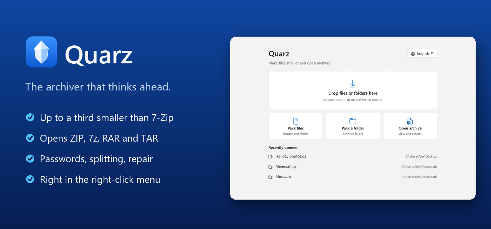
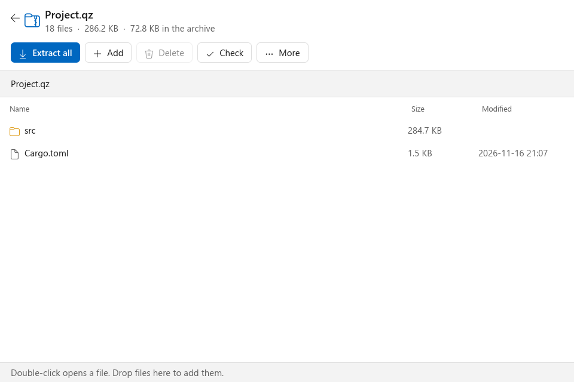
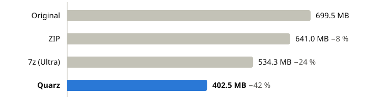
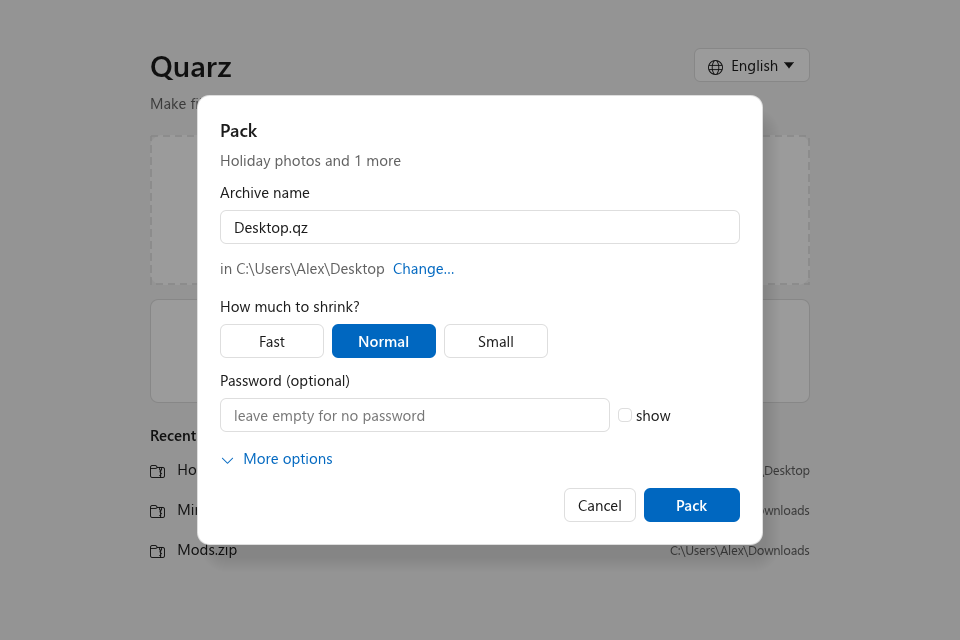
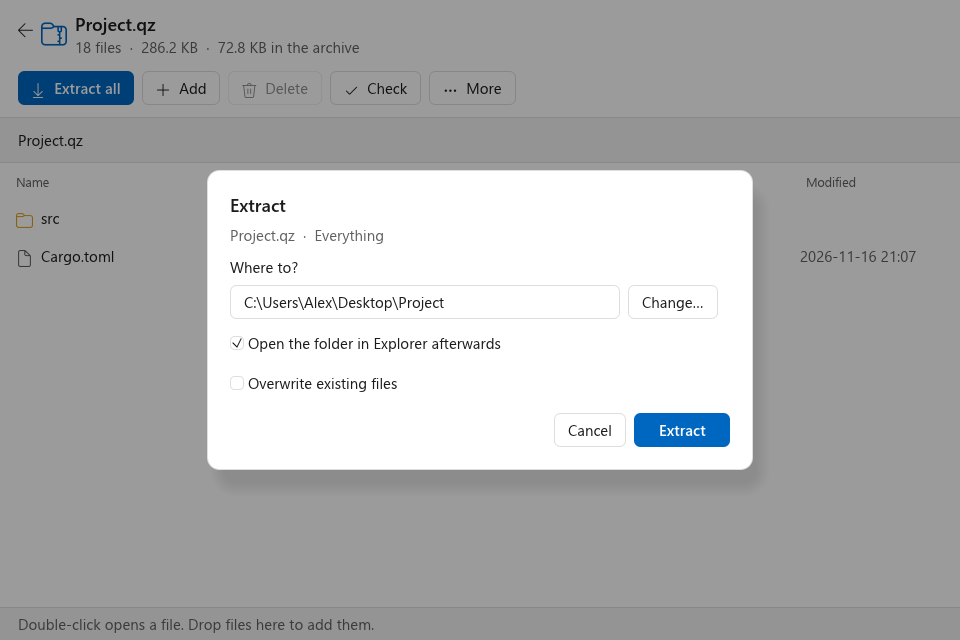
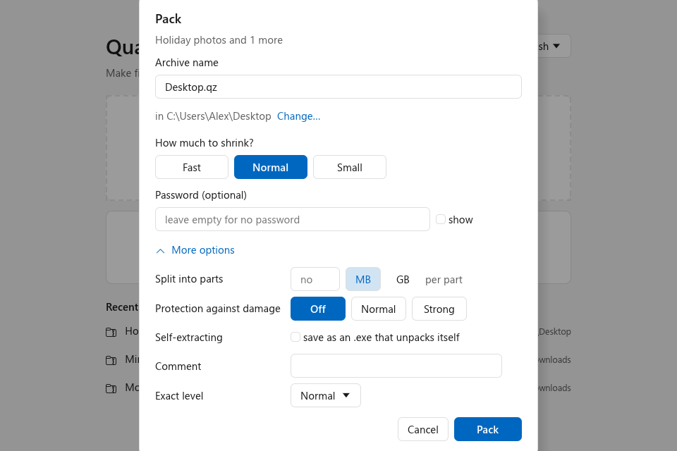
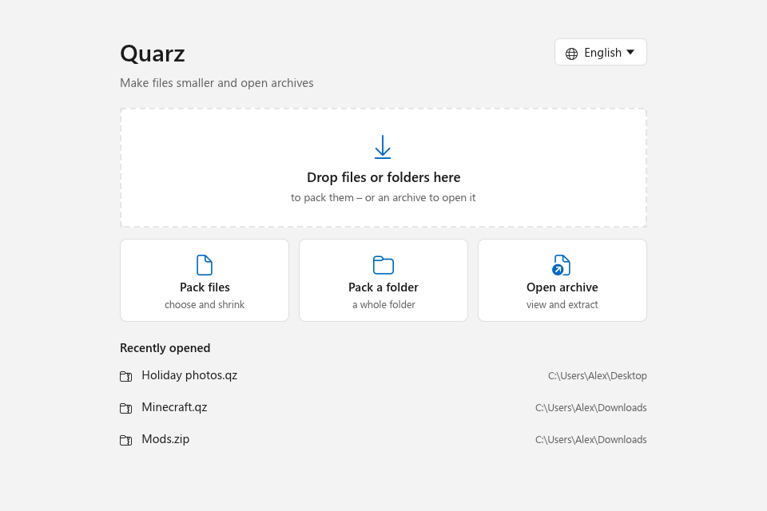
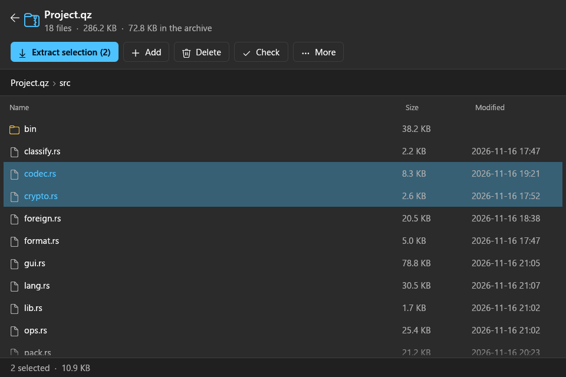
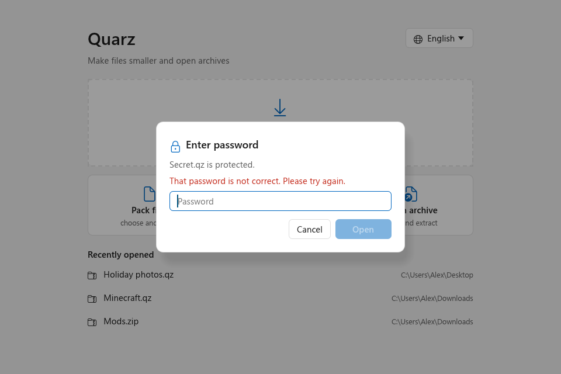
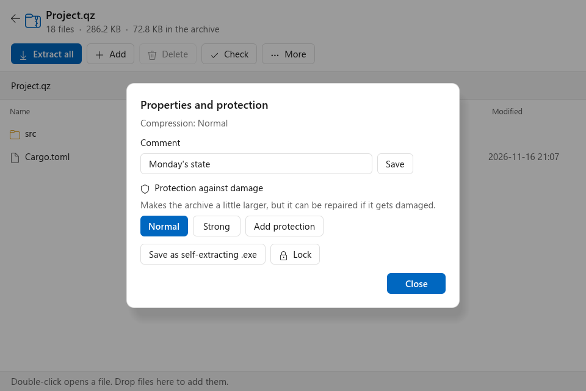

<p align="center">
  <b>English</b> · <a href="README.de.md">Deutsch</a>
</p>

<p align="center">
  
</p>

<p align="center">
  <a href="https://github.com/morgenich/quarz/releases/latest"><b>⬇ Download Quarz</b></a>
  &nbsp;·&nbsp; <a href="#tutorial">Tutorial</a>
  &nbsp;·&nbsp; <a href="#how-much-smaller">Benchmarks</a>
  &nbsp;·&nbsp; <a href="#how-it-works">How it works</a>
</p>

---

**Quarz** packs files and folders smaller than ZIP and 7-Zip – and stays as simple as zipping in Windows itself. Drag, drop, done. And of course it opens archives in other formats too.

- **Smaller.** On real folders, on average **a quarter smaller than 7-Zip Ultra**; for programs and ZIP collections, more than a third.
- **Simple.** One start page, three big buttons, a right-click menu in Explorer. No jargon.
- **Everything you know from WinRAR.** Passwords, splitting into parts, damage protection with repair, self-extracting `.exe`, comments, locking.
- **Opens almost anything.** `.qz`, ZIP, 7z, RAR, TAR, `.tar.gz`, `.tar.xz`, `.tar.bz2`, `.zst`.
- **In your language.** English, Deutsch, Español, Français – light and dark.
- **Bit-exact.** Every file comes out byte for byte as it went in. This is checked while packing.

<p align="center">
  
</p>

## How much smaller?

Measured on six real, mixed folders (699.5 MB together). Quarz at level **Normal**, 7-Zip at **Ultra**, everything extracted again and compared byte for byte:

<p align="center">
  <picture>
    <source media="(prefers-color-scheme: dark)" srcset="docs/images/chart-en-dark.svg">
    
  </picture>
</p>

| Folder | Original | ZIP | 7z Ultra | **Quarz** | Quarz vs 7z |
|---|---:|---:|---:|---:|---:|
| Software project (code, Git, media) | 117.1 MB | 114.4 MB | 77.1 MB | **52.6 MB** | **−31.8 %** |
| Java programs (JAR) | 142.4 MB | 137.9 MB | 115.0 MB | **71.4 MB** | **−38.0 %** |
| Collection of ZIP files | 125.7 MB | 109.5 MB | 100.1 MB | **68.4 MB** | **−31.6 %** |
| Minecraft world | 69.6 MB | 47.1 MB | 44.9 MB | **37.1 MB** | **−17.4 %** |
| PDF documents | 176.4 MB | 166.1 MB | 137.7 MB | **113.2 MB** | **−17.8 %** |
| Screenshots and notes | 68.3 MB | 66.0 MB | 59.5 MB | **59.8 MB** | +0.7 % |
| **Total** | **699.5 MB** | **641.0 MB** | **534.3 MB** | **402.5 MB** | **−24.7 %** |

**To be fair:** Quarz spends more computing time than 7-Zip to get there – several times as much when packing. Photos, videos and screenshots hardly shrink – they are already packed so tightly that no program makes them much smaller.

## Tutorial

### 1. Install

1. Download the latest `Quarz-…-windows.zip` from [**Releases**](https://github.com/morgenich/quarz/releases/latest).
2. Unpack it into a permanent folder, for example `C:\Users\<you>\Programs\Quarz`.
3. Double-click **`Einrichten.cmd`** (“set up”). From then on `.qz` files open with a double-click and Quarz is in the right-click menu.

> **Windows 11:** During setup Quarz asks whether it should appear directly in the *first* right-click menu. Windows only allows signed app packages there, so the certificate of the Quarz package is added as trusted once (Windows asks for administrator approval). If you say no, the entries are under *Show more options*.

To remove it: double-click **`Entfernen.cmd`** (“remove”), then delete the folder.

### 2. Pack

**Fastest:** right-click files or a folder → **Quarz → Pack to “Name.qz”**. Quarz puts the archive next to them and only shows a small progress bar.

**With options:** drop files on the Quarz window, or choose **Pack files** / **Pack a folder**.

<p align="center">
  
</p>

| Setting | Meaning |
|---|---|
| **Fast / Normal / Small** | How much time Quarz takes. *Normal* is the recommended balance. |
| **Password** | Encrypts the content *and* the file names (AES-256). Without the password nobody gets in – not even with Quarz. |
| **More options** | Splitting, protection, self-extracting, comment. See below. |

### 3. Open and extract

Double-click an archive to open it. **Extract all**, or select single files and use **Extract selection**. Double-clicking a file inside the archive opens it directly.

<p align="center">
  
</p>

The right-click menu works without a window too: **Extract here** or **Extract to folder “Name”**.

### 4. Split large archives

Under **More options → Split into parts** enter a size in MB or GB, for example `4 GB` for a USB stick or `25 MB` for e-mail. Quarz then writes `Name.part001.qz`, `Name.part002.qz` and so on.

<p align="center">
  
</p>

- **Extract:** put all parts in the same folder and open any one of them.
- **Join back into one file:** open the archive → **More → Properties and protection → Join the parts into one file**. Or: `qz join Name.part001.qz`.

### 5. Protect against damage

With **Protection against damage** (*Normal* = 5 %, *Strong* = 10 % larger) Quarz stores repair data in the archive. If part of the file breaks later – say, on a failing USB stick – **More → Repair damaged archive** fixes it. Protection can also be added afterwards under *Properties and protection*.

### 6. Self-extracting archives

**Save as an .exe that unpacks itself** creates a file that unpacks itself with a double-click – handy for people who don't have Quarz.

### More pictures

| | |
|---|---|
|  |  |
| Start page | Dark mode |
|  |  |
| Password prompt | Properties and protection |

## Command line

Everything also works with `qz.exe`:

```text
qz add backup.qz "C:\Photos" "C:\Documents"     pack (level 3 = Normal)
qz add backup.qz "C:\Photos" -m 5               pack, level 0 (store) to 5 (best)
qz add backup.qz "C:\Photos" -p -v 4g --rr 5    with password, 4 GB parts, 5 % protection
qz add backup.qz new.txt                        add to an existing archive
qz extract backup.qz -o target                  extract (also ZIP, 7z, RAR, TAR)
qz extract backup.qz "*.jpg" Pictures           only some files
qz list backup.qz                               show the contents
qz test backup.qz                               check everything
qz delete backup.qz old.txt                     remove from the archive
qz repair backup.qz                             repair with the protection data
qz join backup.part001.qz                       join the parts
qz sfx backup.qz                                make a self-extracting .exe
```

## How it works

Most files today have already been compressed once – just badly: JAR and Office files are ZIPs, PNGs contain Deflate data, Minecraft worlds consist of thousands of small zlib chunks, and so do PDFs. An ordinary archiver only sees “noise” in them and gives up.

Quarz works in three steps:

1. **Undo old compression.** Quarz finds such streams, unpacks them and remembers the few bytes needed to recreate them **bit for bit** later – even when another program made them. JPEG photos are recoded losslessly.
2. **Store repeated content once.** Quarz cuts everything at content-defined boundaries. When a piece appears again – in another file, in a ZIP inside a ZIP – it is stored only once.
3. **Sort by kind, then compress.** Text, program code, measurement series and already dense data go into separate streams, each with the method that suits it (LZMA2 or Zstandard).

While packing, every step is immediately reversed and compared with the original. If anything does not match, that file simply stays as it was.

## Status

Quarz is a **young project** (version 0.2, Windows 10/11). It is thoroughly tested but has not been in use for years yet: for irreplaceable data, please keep a second backup as well.

Known limits:
- Packing takes clearly more computing time than 7-Zip; extracting a little more too.
- Deleting from an archive does not free the space yet; split archives cannot be changed.
- Quarz opens foreign formats (ZIP, 7z, RAR, TAR) but does not write them.

## Building it yourself

Needs [Rust](https://rustup.rs) and the Visual Studio Build Tools.

```text
cargo build --release --workspace
```

`qz.exe`, `quarz.exe` and `quarz_shell.dll` are then in `target\release`. The pictures on this page are made with `cargo run --example shots -- <folder> en` and `python docs/make_images.py <folder>`.
